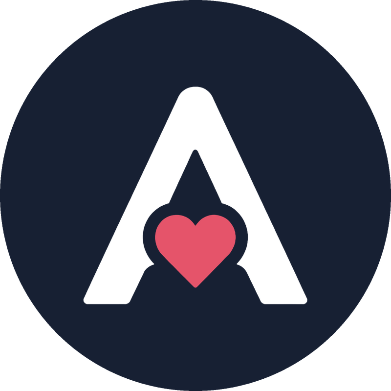

<div align="center">



# ADA — Alerta, Defesa e Apoio

**Pedir ajuda em situações de risco, com poucos toques.**


</div>

---

## 💡 Sobre o projeto

O **ADA** é um aplicativo mobile pensado para **mulheres em situação de vulnerabilidade**.
A proposta é oferecer uma forma **rápida e simples de pedir ajuda em situações de risco**, reduzindo o esforço e o tempo necessários nesses momentos.

> 📅 **Mostra científica:** o ADA será apresentado no Centro Universitário Cesuca em **12/11/2026**.
>
> 🚧 **Projeto em desenvolvimento.** O app está sendo construído em etapas, e a ideia, o escopo e as funcionalidades ainda podem mudar ao longo do caminho.

## 📍 Onde estamos

| Fase | Entrega | Situação |
|---|---|---|
| 0 e 1 | Viabilidade, fundamentos e estrutura do projeto | ✅ |
| 2 | Tema e design system (cores, fonte Nunito, cores dos modos 🔵🟡🔴) | ✅ |
| 3 | Telas estáticas: Home, Rede, Novo contato, Configurações, Mensagens e Editar mensagem | ✅ (faltam splash, onboarding e permissões) |
| 4 | Navegação (`go_router`, barra inferior) e estado do modo atual (`provider`) | ✅ |
| 5 | Rede de contatos: cadastrar, editar e remover (até 5), com validação e armazenamento seguro | ✅ |
| 6 | Mensagens de emergência: texto padrão, edição, validação (até 200 letras) e armazenamento seguro | ✅ |
| 7 | Modos Atenção e Perigo: ativar, confirmar o Perigo, desativar com segurança e vibração | ✅ |
| 8 | Localização: permissões, localização atual na aba Mapa e link de mapa para o alerta | ✅ |
| 9 | Alerta de verdade: SMS automático à rede, ligação ao contato de plantão, WhatsApp com mensagem pronta e tela de progresso | ✅ (SMS direto a confirmar em aparelho real) |
| 10 em diante | Horário de cobertura, qualidade e entrega final | 🔜 Fase 10 a seguir |

O plano de cada fase está em [`docs/planejamento/`](docs/planejamento/) e a lista de itens em [`docs/BACKLOG.md`](docs/BACKLOG.md).

## 🧰 Tecnologias

- **Flutter** e **Dart**, com Material Design 3
- **Android** como plataforma principal
- **Figma** para o design das telas, lido pelo Claude Code via MCP
- **go_router** (navegação), **provider** (estado), **flutter_secure_storage** (contatos e mensagens guardados com criptografia), **geolocator** (localização), **permission_handler** (permissões) e **url_launcher** (WhatsApp, SMS e discador)
- **Nunito** como fonte e **Lucide** como família de ícones (pacote `lucide_icons_flutter`)

## ▶️ Como rodar

**Pré-requisito:** [Flutter](https://docs.flutter.dev/get-started/install) instalado (desenvolvido com a versão 3.47.6, canal stable).

```bash
git clone https://github.com/gabbiefl/ada_app.git
cd ada_app
flutter pub get          # baixa as dependências
flutter run -d chrome    # roda no navegador
```

Com o app rodando: `r` faz hot reload, `R` faz hot restart e `q` encerra.

Para conferir a qualidade do código: `flutter analyze` e `flutter test`.

> 🚧 Por enquanto o desenvolvimento acontece no Chrome. A execução em emulador ou celular Android será documentada quando o ambiente Android for configurado.
>
> 💡 **Windows:** evite deixar o projeto dentro do OneDrive. A sincronização pode travar a pasta `build/` e fazer o `flutter run` falhar.

## 🗂️ Estrutura do código

```
lib/
├── core/
│   ├── routes/     # mapa de telas e endereços (go_router)
│   ├── state/      # estado global (SecurityMode, ModeController)
│   ├── theme/      # cores, textos e tema do app (AppTheme, ModeColors)
│   └── widgets/    # widgets usados em várias telas (barra de navegação, cabeçalho)
└── features/       # uma pasta por funcionalidade (home, contacts, modes...)
    ├── home/  contacts/  settings/  messages/
    │   ├── pages/    # telas
    │   └── widgets/  # peças da tela (anéis, cards, chips...)
```

## 📚 Aprendizado

Os resumos de Flutter e Dart escritos ao longo do projeto estão em [`docs/aprendizado/`](docs/aprendizado/).

## 👩‍💻 Autoria

Projeto acadêmico desenvolvido por [@gabbiefl](https://github.com/gabbiefl), com foco em aprendizado de Flutter e Dart.
